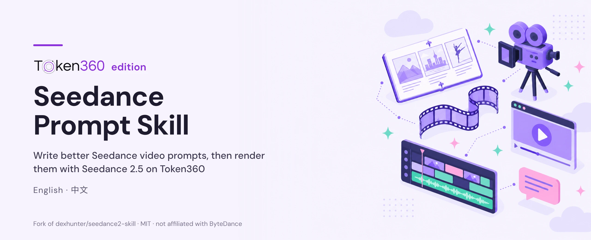
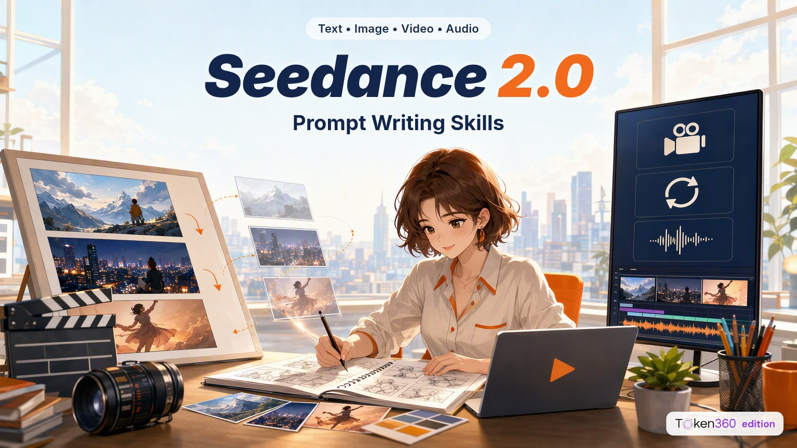

# Seedance 2.0 Prompt Writing Skills · Token360 edition

[中文](README-zh.md)

> [!NOTE]
> **Forked from [dexhunter/seedance2-skill](https://github.com/dexhunter/seedance2-skill) by [Dex (dexhunter)](https://github.com/dexhunter), licensed MIT. All credit for the original work goes to them.**
>
> The skill files, prompt patterns and templates are Dex's work (see the [upstream contributors](https://github.com/dexhunter/seedance2-skill/graphs/contributors)). This Token360 edition only adds an optional "render on Token360" step: a small video script, a quick start, a Seedance 2.5 note, a new header and thumbnail, and sample clips generated with Token360. It is not affiliated with or endorsed by the original author. The original [LICENSE](LICENSE) and copyright notice (Copyright (c) 2026 Dex) are unchanged; every change is listed in [NOTICE](NOTICE). Please ⭐ the [original project](https://github.com/dexhunter/seedance2-skill), and send improvements that aren't Token360-specific upstream.
>
> **Not affiliated with ByteDance.** Seedance, Jimeng (即梦) and Dreamina are products and trademarks of ByteDance. The skill content summarizes ByteDance's public Seedance 2.0 manual and case studies (see [Sources](#sources)); this fork is not affiliated with, sponsored by or endorsed by ByteDance.

## ⚡ Token360 quick start

Write the prompt with the skill, then render it with Seedance 2.5 through Token360's OpenAI-compatible API. Python 3.8+, standard library only.

1. Create an account and an API key: [sign up at token360.ai](https://www.token360.ai/en-US/sign-up?utm_source=github&utm_medium=fork&utm_campaign=seedance-prompt-skill)
2. Render a clip:

```bash
export TOKEN360_API_KEY="sk-..."                         # your key (never commit it)
export TOKEN360_BASE_URL="https://api.token360.ai/v1"    # default, shown for clarity
python3 scripts/token360_video.py --model seedance-2.5 \
  --prompt "Static camera. A sage-green ceramic mug on a wooden table, steam curling up in soft morning light, dust motes drifting. Calm ambient music." \
  --resolution 480p --duration 4 --out mug.mp4
# → {"ok": true, "file": "mug.mp4", ...}   (usually 2–5 minutes; this 4 s 480p clip cost $0.54 in our test)
```

The script calls `POST /v1/videos`, polls `GET /v1/videos/{id}` and downloads the result. Use `--resolution 720p|1080p`, `--duration 4-30`, `--aspect-ratio 9:16`, `--no-audio`, `--first-frame <image URL>`, `--ref-image <image URL>`, or `--model seedance-2.0 | seedance-2.0-fast | seedance-2.0-mini`. See `python3 scripts/token360_video.py -h`, [all video models and prices](https://www.token360.ai/en-US/explore?utm_source=github&utm_medium=fork&utm_campaign=seedance-prompt-skill) and the [docs](https://www.token360.ai/en-US/docs?utm_source=github&utm_medium=fork&utm_campaign=seedance-prompt-skill). If a job fails with `content_policy_violation` ("generated audio may violate copyright restrictions"), simply run it again or add `--no-audio`; in our tests the same prompt passed on retry and failed jobs were not billed. The skill itself is provider-neutral: prompts still work in Jimeng / Dreamina or any other Seedance provider.

## 🎬 Made with Token360

Four 5-second clips rendered with **Seedance 2.5 on Token360** from prompts written with this skill's patterns (product ad, dialogue, science explainer, one-take). Click a preview for the mp4 with sound; prompts and costs are in [examples/token360-samples](examples/token360-samples/README.md).

| Product ad (§9) | Dialogue & voice (§7) |
|---|---|
| <a href="examples/token360-samples/product-ad.mp4"></a> | <a href="examples/token360-samples/dialogue-comedy.mp4"></a> |
| **Science / education (§10)** | **One-take (§8)** |
| <a href="examples/token360-samples/science-edu.mp4"></a> | <a href="examples/token360-samples/one-take.mp4"></a> |

<br>
<sub>Repository thumbnail, regenerated with <code>gpt-image-2</code> on Token360 from the repo's own <a href="assets/thumbnail-prompt.txt">thumbnail prompt</a> (text added afterwards, not by the model).</sub>

[Agent skills](https://agentskills.io) for writing effective video generation prompts for [Jimeng Seedance 2.0](https://jimeng.jianying.com/), ByteDance's multimodal AI video generation model. Works with Claude Code, Cursor, Cline, and other compatible agents.

Covers input constraints, @ reference syntax, camera language, prompt structure patterns, and ready-to-use templates for ads, dramas, MVs, educational content, and more.

## Install

### Option A: Manual copy (recommended)

Clone or download this repository, then copy the skill file(s) to your Claude skills directory:

```bash
mkdir -p ~/.claude/skills

# English
cp SKILL.md ~/.claude/skills/seedance-prompt-en.md

# Chinese
cp zh/SKILL.md ~/.claude/skills/seedance-prompt-zh.md
```

### Option B: Via skills CLI

```bash
npx skills add dexhunter/seedance2-skill
```

(This installs the original upstream skill. For this Token360 edition, use the fork's repository path once it is published.)

Then ask your AI agent to help you write a Seedance 2.0 video prompt.

## Skills

| File | Language | Description |
|---|---|---|
| [SKILL.md](SKILL.md) | English | Prompt writing guide for Seedance 2.0 |
| [zh/SKILL.md](zh/SKILL.md) | 中文 | Seedance 2.0 提示词撰写指南 |
| [scripts/token360_video.py](scripts/token360_video.py) | — | Token360 edition: optional script to render a prompt with Seedance on Token360 |

## Sources

Based on official ByteDance documentation:

- [Seedance 2.0 User Manual](https://bytedance.larkoffice.com/wiki/A5RHwWhoBiOnjukIIw6cu5ybnXQ) — Parameters, interaction methods, multimodal capabilities, and example prompts
- [Seedance 2.0 Real-world Cases](https://bytedance.larkoffice.com/wiki/LJXzwehluiFdzKkb1recZdfonZg) — Drama production, e-commerce ads, dance imitation, science education, AI MVs, and more

## Differences from upstream (Token360 edition)

- Added `scripts/token360_video.py`, the Token360 quick start, `.env.example` and the sample clips in `examples/token360-samples/`
- Added an optional "Render on Token360" section and a Seedance 2.5 note to `SKILL.md` and `zh/SKILL.md`; the original guide is unchanged
- Replaced the header: the original `assets/seedance2-thumbnail.png` was removed; `assets/thumbnail-token360.jpg` was regenerated with Token360 from the repo's own `assets/thumbnail-prompt.txt` (text instructions replaced by "no text", see `assets/thumbnail-prompt-token360.txt`; the title was overlaid afterwards)
- Full list in [NOTICE](NOTICE)

## License

[MIT](LICENSE). Original copyright notice retained; Token360 changes are described in [NOTICE](NOTICE).
